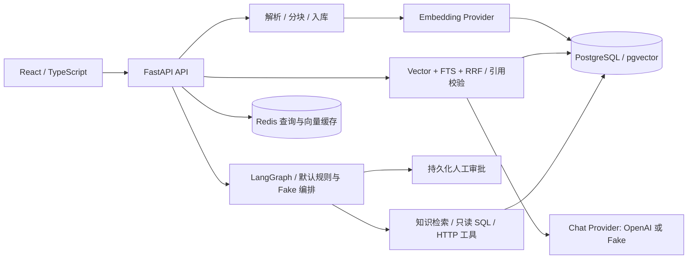

# NexusAI

面向企业文档检索、来源引用和受控工具编排的全栈开发项目。用户可建立知识库、导入文件或网页，通过混合检索获取回答，并在需要写入业务数据时进入人工审批流程。

**当前定位：工程实践项目，非生产 SaaS。** RAG 具备 OpenAI 接口与明确的 Fake Provider；Agent 默认 Planner、Router、Verifier 为规则/Fake 实现，不能视为已验证的真实模型自主规划。MCP 与 Coding Agent 仍属后续规划。

## 1. 项目简介

项目关注从文档入库到可追溯回答的完整链路：解析、分块、Embedding、召回融合、上下文预算、引用校验及 SSE；同时提供受控 SQL、审批工作流和文档分析原型。

本分支修复源码遗漏：只放行 `backend/app/data/` 下的六个 Python 文件，数据库、用户上传、凭据和缓存继续忽略。此前 2026-10-18 独立副本完成导入、74 项离线测试和独立 HTTP 健康检查；真实 PostgreSQL 集成未在本轮执行。

## 2. 技术栈

| 层 | 已使用技术 |
| --- | --- |
| 后端 | Python 3.12+、FastAPI、Pydantic、SQLAlchemy async、Alembic |
| AI / 检索 | LangGraph、OpenAI 接口、pgvector、PostgreSQL FTS、RRF，可选 Cohere/Tavily |
| 存储 | PostgreSQL、Redis、本地文件存储 |
| 前端 | React、TypeScript、Vite |
| 工程 | Docker Compose、pytest；前端依赖以 lockfile 为准 |

## 3. 系统架构



Compose 当前只启动 PostgreSQL/pgvector 和 Redis，API 与前端由本地进程启动；没有完整应用容器部署通过声明。

## 4. 核心功能

| 能力 | 源码入口 |
| --- | --- |
| PDF、DOCX、TXT、Markdown、URL 与受限网站入库 | [ingestion](backend/app/knowledge/ingestion/pipeline.py)、[parsers](backend/app/knowledge/parsers/) |
| 混合召回、上下文预算、引用及 SSE | [hybrid.py](backend/app/knowledge/retrieval/hybrid.py)、[RAG pipeline](backend/app/knowledge/rag/pipeline.py) |
| 工具权限、审批暂停与恢复 | [Agent Runtime](backend/app/agents/runtime/executor.py)、[审批服务](backend/app/agents/approval/service.py) |
| Schema 检索、Text-to-SQL 与只读执行 | [data](backend/app/data/)、[SQLReadOnlyTool](backend/app/agents/tools/sql_readonly.py) |
| 客服审批及合同字段、规则风险、章节比较 | [customer tools](backend/app/agents/tools/customer.py)、[documents](backend/app/documents/) |

## 5. 关键工程实现与源码位置

- **召回结果需要兼顾语义与关键词。** 独立向量检索和 PostgreSQL FTS 经 RRF 融合，再构建上下文与合法引用；见 [HybridRetriever](backend/app/knowledge/retrieval/hybrid.py) 与 [RAG 测试](backend/tests/test_rag.py)。文件名 `bm25.py` 中实际为 FTS cover-density ranking，不宣称完整 Okapi BM25。
- **模型生成 SQL 不能直接执行。** [sql_readonly.py](backend/app/agents/tools/sql_readonly.py) 使用 sqlglot、只读事务、Schema/Table allowlist、行数和超时限制。它是应用级控制，不能替代生产数据库最小权限账户。
- **高风险意图需要独立确认。** 工具调用先保存审批，运行进入 waiting 状态，再按持久化决定恢复；当前不宣称任意节点崩溃后的 exactly-once 执行。

## 6. 本地部署教程

环境：Python 3.12+、Node.js（满足已锁定 Vite 的要求）、Docker Compose。仅在新的开发工作目录执行；真实 API Key 不进入示例、前端或 Git。

```powershell
git clone https://github.com/tangwencan666/NexusAI.git
cd NexusAI
Copy-Item .env.example .env
docker compose up -d
cd backend
python -m venv .venv
./.venv/Scripts/python.exe -m pip install -e ".[dev]"
Copy-Item .env.example .env
# 编辑本机私有配置：LLM_PROVIDER=fake、EMBEDDING_PROVIDER=fake 可用于离线开发
./.venv/Scripts/python.exe -m alembic upgrade head
./.venv/Scripts/python.exe -m uvicorn app.main:app --host 127.0.0.1 --port 8000
```

另开终端进入 `frontend`，执行 `npm ci`、`npm run dev`，访问 `http://127.0.0.1:5173`。健康接口为 `http://127.0.0.1:8000/api/v1/health`，OpenAPI 为 `/docs`。已有环境也可阅读 [启动脚本](scripts/start-nexusai.ps1) 后运行根目录 `start.ps1`。

必要配置为数据库/Redis 地址、`LLM_PROVIDER` 和 `EMBEDDING_PROVIDER`。只有明确选择真实供应商并自行注入服务端 Key 后才使用外部模型。Compose 默认开发口令与端口绑定不适合公网生产。

**请使用包含六个源码文件的完整版本。** 本分支已包含修复；如果只在 Pull Request 中看到本文，合并前需先检出对应 PR 分支，再执行上述步骤。若出现 `app.data` 导入错误，检查是否已包含完整源码；数据库连接失败时先核对私有配置与 Compose 健康状态，不清空卷。

## 7. 真实运行截图

待补充真实前端运行截图。本轮仅验证了隔离 API 导入和健康接口，没有生成或拼接界面，也没有公开演示地址。

## 8. 测试结果与已知限制

```powershell
cd backend
./.venv/Scripts/python.exe -m pytest -m "not integration" -q
# 暂不直接启用 RUN_INTEGRATION：现有一个测试硬编码 localhost:5432，见下方限制
```

| 验证 | 2026-10-18 结果与边界 |
| --- | --- |
| 2026-10-18 独立克隆与六源码补丁 | 六个模块可导入；独立 uvicorn 健康接口 HTTP 200 |
| 离线测试 | 74 passed，3 integration 用例 deselected；没有付费模型请求 |
| 真实 PostgreSQL / Redis / 供应商 | 本轮未重跑，不以 Fake 测试替代 |
| 链接与架构 | 随本轮文档校验，详见下方验证记录 |

当前缺少生产身份治理、完整多租户权限和部署验收；Workspace 数据模型不等同于租户隔离。Text-to-SQL 还包含显式演示规则；真实模型效果没有系统评测结论。现有 `test_rag_integration.py` 硬编码 localhost:5432 开发 DSN，不能仅设置 RUN_INTEGRATION 就安全切换到独立数据库；需后续单独改造测试配置，本轮没有执行它。

[阶段 B 历史记录](docs/PORTFOLIO_VERIFICATION.md) · [架构说明](docs/architecture.md) · [原 README 历史](docs/history/README.before-portfolio-20261018.md)

[本地验收记录](docs/LOCAL_ACCEPTANCE.md) · [测试证据及版本索引](docs/TEST_EVIDENCE.md)
